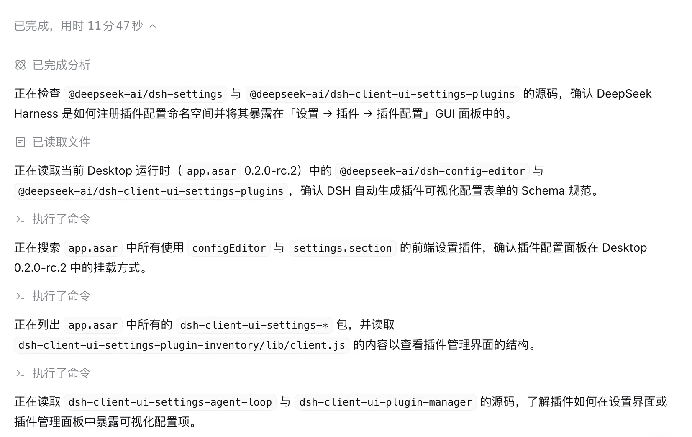
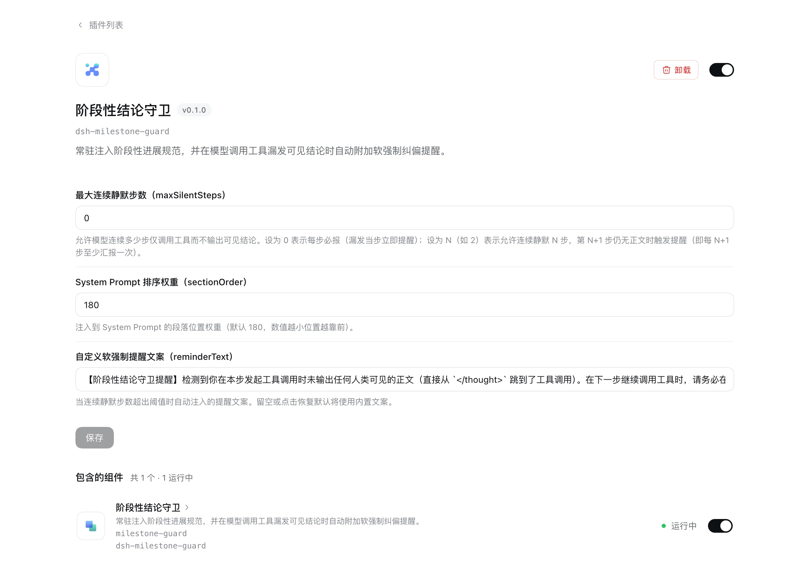
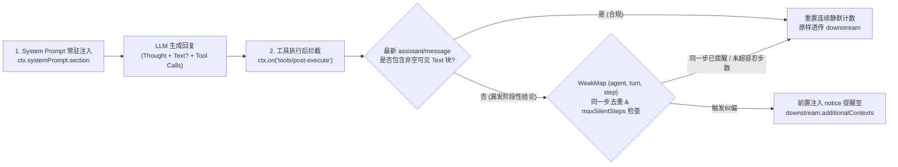

# dsh-milestone-guard

**阶段性结论软强制守卫插件（Milestone Progress Soft-Enforcement Guard for DeepSeek Harness）**

`dsh-milestone-guard` 是一个面向 **DeepSeek Harness (DSH)** 的轻量级 Cordis 插件。它通过 **「System Prompt 常驻规范注入 + `tools/post-execute` 瀑布流软强制纠偏提醒 + GUI 可视化热更新配置」** 的机制，解决思考模型（Reasoning Models）在长链路 Agent 任务中常见的两大痛点：

1. **黑盒静默调用工具（Silent Tool Calling）**：模型将所有推理过程隐藏在 `<thought>` 块内，随后直接跳到 `<call:...>` 发起数十次工具调用而不输出任何人类可见正文；当 GUI 默认折叠思考过程时，用户只能看到一排工具刷屏，无法获知上一步验证的结论或下一步意图。
2. **纯文本汇报导致回合误判中断（Premature Turn Termination）**：当开发者在 Prompt 中要求模型“汇报阶段性进展”时，模型容易单独输出一条不带工具调用的纯文本消息，导致 Agent 主循环误判当前回合（Turn）已结束而提前停顿。





---

## 核心效果对比 (Before vs. After)

| 场景 | 未启用 `dsh-milestone-guard` | 启用 `dsh-milestone-guard` 后 |
| :--- | :--- | :--- |
| **连续工具调用时** | 模型从 `</thought>` 直接跳到 `<call:read>`、`<call:grep>`，界面只见工具刷屏，没有任何阶段性结论。 | 发起工具调用前自动附带 1~2 句简明人类可见结论（如：“*已确认配置文件入口，接下来检查中间件注册逻辑*”）。 |
| **中途汇报进展时** | 模型单独发送一段纯文本总结而不带工具调用，导致 Agent 循环直接中断等待用户输入。 | 强制要求**阶段性结论必须与下一步工具调用（或 `todo_write`）在同一回复中并发发出**，长链路一气呵成。 |
| **长链路注意力衰减时** | 随着上下文增长，模型逐渐遗忘 System Prompt 规范，恢复静默调用工具。 | `tools/post-execute` 自动检测静默步并在 `additionalContexts` 前置注入 `notice` 软提醒，下一轮立即恢复规范输出，且**不打断、不浪费当前工具执行结果**。 |

---

## 工作原理 (Architecture)



### 关键技术设计
* **零损耗软强制（Non-blocking Soft Enforcement）**：不在 `tools/pre-execute` 阶段粗暴阻断（`block`）工具执行，而是让工具正常执行完毕后，在 `tools/post-execute` 阶段向 `downstream.additionalContexts` 前置附加一条 `notice` 提醒消息，兼顾执行效率与纠偏效果。
* **步级并发去重与防内存泄漏**：当模型在同一个 `(turn, step)` 中并发调用多个工具（如同时调用 5 次 `read`）时，基于 `WeakMap<Agent, State>` 按 `(agent, turn, step)` 去重，确保同一步只评估并注入一次提醒，且随 Agent 实例销毁自动回收内存。
* **GUI 可视化配置与 `.volatile()` 热更新**：内置客户端配置组件（[`lib/client.js`](<lib/client.js>)），在 DeepSeek Harness「插件 → 已安装 → 阶段性结论守卫」页面直接提供可视化配置表单，修改后无需重启会话即可实时生效。
* **零外部强依赖与多版本兼容**：
  * 自动兼容 `session.events`（数组属性）、`session.snapshotEvents()`（DSH 0.1.5+ / 0.2.0+ 方法）与 `session.log`；
  * 对 `@deepseek-ai/dsh-llm` 和 `@deepseek-ai/schemastery` 提供宿主动态解析与内置零依赖 Fallback（含 `toJSON()` 与 Standard Schema `~standard` 协议），可在纯 Node.js 环境独立运行和测试。

---

## 安装与配置 (Installation & Configuration)

### 方式一：在 DeepSeek Harness GUI 中安装与可视化配置
1. 在 DeepSeek Harness「**插件 (Plugins)** → **添加插件**」中填入本地路径或仓库地址进行安装。
2. 点击「**插件** → **已安装** → **阶段性结论守卫 (`dsh-milestone-guard`)**」，即可在详情面板中直接修改：
   * **最大连续静默步数 (`maxSilentSteps`)**
   * **System Prompt 排序权重 (`sectionOrder`)**
   * **自定义软强制提醒文案 (`reminderText`)**

### 方式二：在 `cordis.patch.yml` 中配置
```yaml
- id: milestone-guard
  name: dsh-milestone-guard
  config:
    enabled: true
    locale: zh
    sectionOrder: 180
    maxSilentSteps: 0
    ignoreTools: []
```

---

## 配置项说明 (Configuration Options)

| 配置项 | 类型 | 默认值 | 说明 |
| :--- | :--- | :--- | :--- |
| `enabled` | `boolean` | `true` | 是否启用本插件。 |
| `locale` | `'zh' \| 'en'` | `'zh'` | 内置 System Prompt 规范与软强制提醒文本的语言预设（支持中英双语开箱即用）。 |
| `sectionOrder` | `number` | `180` | 注入到 System Prompt 的段落排序权重（支持 GUI 热更新，数值越小位置越靠前）。 |
| `maxSilentSteps` | `number` | `0` | 允许模型连续多少步仅调用工具而不输出可见结论（支持 GUI 热更新）。默认 `0` 表示每步必报（当步漏发立即提醒）；设为 `N`（如 `2`）表示允许连续静默 `2` 步，第 `3` 步仍无正文时才触发提醒（即每 `N+1` 步至少汇报一次）。同时支持别名 `everySteps: N`（自动换算为 `maxSilentSteps: N - 1`）。 |
| `ignoreTools` | `string[]` | `[]` | 忽略的工具名称列表（例如 `["todo_write"]`）。当某一步仅调用了列表内的工具时，不触发漏发阶段性结论提醒。 |
| `promptText` | `string` | *(内置预设)* | 自定义注入到 System Prompt 的规范正文；留空时自动使用 `locale` 对应的内置预设。 |
| `reminderText` | `string` | *(内置预设)* | 自定义检测到静默工具调用时注入的软提醒文本（支持 GUI 热更新）；留空或恢复默认时使用内置预设。 |

---

## 开发与测试 (Development & Testing)

本项目使用 Node.js 原生测试运行器（`node:test`），无需安装额外测试框架即可验证全部核心行为：

```bash
npm test
```

## License

[MIT](<LICENSE>)
